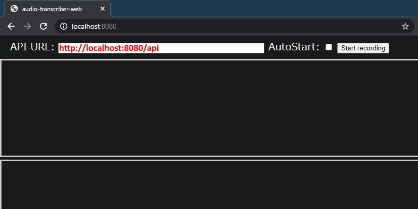

# audio-transcriber-web

[Click here for English README](README.md)

ブラウザを用いてマイクからの音声を`SpeechRecognition`を使って自動的に書き起こし、ファイルに書き込む。

- [GitHub Pages](https://book000.github.io/audio-transcriber-web/static/index.html)
- 動画・音声ファイルからの文字起こしは[book000/audio-transcriber-docker](https://github.com/book000/audio-transcriber-docker)

## Warning / Disclaimer

**このプロジェクトを使用したことによって引き起こされた問題に関して開発者は一切の責任を負いません。**

というか、それなりに真面目なことに使うのであれば[Google Cloud PlatformのSpeech-to-Text](https://cloud.google.com/speech-to-text)とかを使いましょう。  
一切のサポートはしません。

## Feature

- `API URL`を入力することで、指定したアドレスに書き起こしたテキストを自動的に送信します。
- `AutoStart`機能をオンにすることで、ページにアクセスした時やリロードした瞬間から録音を開始します。(beta)
- `Display timestamp`をオンにすると、各結果に経過秒数の代わりに日時を表示します。
- `API URL`、`AutoStart`、`Display timestamp`の設定内容は[localStorage](https://developer.mozilla.org/ja/docs/Web/API/Window/localStorage)に保存し、保持します。
- 結果にホバーすると、認識の別候補とその差分を表示します。

## Requirements

- Chrome 33+ / Edge 79+ ([Can I use SpeechRecognition?](https://caniuse.com/mdn-api_speechrecognition))
- Python 3.11+ (Python バックエンドを使う場合のみ)
- `requirements.txt`: fastapi, uvicorn

## Installation & Usage

### 1. Git Clone

`git clone https://github.com/book000/audio-transcriber-web.git`

### 2. Install packages from `requirements.txt`

`pip3 install -U -r requirements.txt`

### 3. Run `main.py --open-browser`

`python3 main.py --open-browser`

### 4. Type `http://localhost:8080/api` in the `API URL` form



### 5. Click the `Start recording`

`AutoStart`をオンにしておくとページにアクセスした瞬間から録音開始します。

## Notes

- 権限、サービス、マイクなどの再試行できない音声認識エラーが発生すると録音を停止します。表示された問題を解消してから `Start recording` をクリックしてください。ネットワークエラー、音声未検出エラー、確定した認識結果がないままの終了では、1 秒、2 秒、4 秒後に最大 3 回連続で再試行します。空でない確定結果を取得すると再試行回数をリセットし、`Stop recording` をクリックすると待機中の再試行を取り消します。
- 書き起こしは録音開始時刻 (サーバのローカル時刻) を名前にした `<YYYY-MM-DD HH-MM-SS>.log` と `.json` に保存されます。`main.py` は `data/` に、`api.php` は環境変数 `TRANSCRIPT_DATA_DIR` で指定したディレクトリに書き込みます。
- アップロードは認識順に送信されます。両バックエンドでは、録音ごとに増加する正の整数 `revision` (最大 `9007199254740991`) が必要です。フロントエンドとバックエンドを同時に更新してください。古いリビジョンや重複するリビジョンは保存済みの音声認識結果を置き換えません。
- 両バックエンドは書き込み前に JSON オブジェクトを検証します。`startTime` は `0` 以上 `4102444800` 未満 (UTC の 2100-01-01 未満) の数値で、小数秒は切り捨てます。`transcript` は UTF-8 で最大 65,536 バイトの文字列です。`full` は最大 10,000 個のオブジェクトの配列で、各要素には `0` 以上 `4102444799` 以下の整数 `timeStamp` (経過秒) と、同じバイト数制限の `transcript` 文字列が必要です。`full` 内の文字起こしの合計は UTF-8 で 1,048,576 バイト以下にしてください。空文字列と空配列は使用できます。未知のフィールドは無視し、トップレベルの `timeStamp` は引き続き省略可能で使用しません。不正な入力には保存済みスナップショットを変更せず HTTP 422 (Python) または 400 (PHP) を返し、保存に失敗した場合は HTTP 500 を返します。
- セッションの `.snapshot.json` と `.lock` は書き起こしファイルと一緒に保持してください。スナップショットには受け付けたリビジョンと全文が保存され、出力が中断した場合は後続のリクエストで復元されます。各ファイルはセッションロック下で原子的に置き換えられますが、全ファイルが一括で原子的に公開されるわけではありません。
- `api.php`をどこかのサーバにおいてそこへのアドレスを`API URL`に設定して動作させることもできます。
  - PHP の `TRANSCRIPT_DATA_DIR` に、**Web サーバのドキュメントルートの外**にあり、親ディレクトリが存在する絶対パスを設定してください (作成されるのは最後の要素のみです)。ドキュメントルート内に置くと、録音開始時刻を推測した人は誰でもダウンロードできてしまいます。未設定の間、`api.php` は `POST` と `HEAD` に HTTP 500 を返し、何も書き込みません。
  - PHP-FPM では、プール設定に `env[TRANSCRIPT_DATA_DIR] = /var/lib/audio-transcriber` を追加します。FastCGI を使う nginx では `fastcgi_param TRANSCRIPT_DATA_DIR /var/lib/audio-transcriber;` を追加します。PHP の実行ユーザーが書き込める必要があります。
  - `<ドキュメントルート>/data/` に書き込んでいた版からの更新では、変数を設定したうえで、古いファイルをドキュメントルートの外へ手作業で移してください。
- バックエンドなしでもフロントエンドだけで動作します。`static/index.html` (または GitHub Pages) を開き、`API URL` は空のままにしてください。

### 別オリジンのバックエンドを使う場合

クロスオリジンアクセスは既定で無効です。従来の認証なしの同一オリジン・直接 HTTP クライアントでの利用は、信頼できる LAN 内だけを想定しています。バックエンドは LAN のファイアウォール内に置いてください。CORS を有効にしても、インターネットへの公開運用をサポートするものではありません。

どちらのバックエンドでも、`TRANSCRIPT_ALLOWED_ORIGINS` にフロントエンドの正確なオリジンをカンマ区切りで設定します。例は `https://book000.github.io,http://localhost:8000` です。スキームと、標準以外のポートを含め、パスや末尾のスラッシュは付けないでください。ワイルドカードと `null` オリジン (`file://` のページを含む) は拒否されます。ローカルのフロントエンドも HTTP で配信してください。

併せて `TRANSCRIPT_API_TOKEN` にランダムに生成した長い秘密の値を設定し、録音前にフロントエンドの `API token` 欄へ入力してください。トークンはページ内だけに保持され、localStorage には保存されません。再読み込み後は再入力してください。設定した場合、同一オリジンや直接 HTTP クライアントも含め、すべての `POST` と `HEAD` に `Authorization: Bearer <token>` が必要です。プリフライトの `OPTIONS` にトークンは不要です。オリジンの許可リストが空でないのにトークンがない場合や、オリジンの形式が不正な場合、API は HTTP 503 を返し、CORS を許可せずファイルも書き込みません。

```bash
export TRANSCRIPT_ALLOWED_ORIGINS=https://book000.github.io
read -rsp 'API token: ' TRANSCRIPT_API_TOKEN; echo
export TRANSCRIPT_API_TOKEN
python3 main.py
```

PHP-FPM では、`TRANSCRIPT_DATA_DIR` と同様にプールの `env[...]` 設定で両方の変数を公開し、Web サーバから PHP へ `Authorization` ヘッダーが転送されるようにしてください。nginx/FastCGI では `fastcgi_param HTTP_AUTHORIZATION $http_authorization;` で設定できます。許可リストにない別オリジンからのリクエストは、有効なトークンがあっても書き込み前に拒否されます。信頼できるホストの外へトークンや書き起こしを送る場合は HTTPS を使ってください。混在コンテンツの制限やブラウザのローカルネットワークアクセスポリシーは CORS とは別に適用されます。許可リストで有効になるのは `HEAD`、JSON の `POST`、`OPTIONS` と `Content-Type`・`Authorization` ヘッダーで、Cookie 認証は使用しません。

## Tests

```bash
node tests/speech-recognition-support.test.js
python3 -m unittest discover -s tests -p 'test_*.py' -v
```

Python テストはインストール済みの `requirements.txt` の依存関係を使用し、一時ディレクトリ内で独立した HTTP バックエンドを起動します。`PATH` 上で `php` が利用可能なら、共通の契約フィクスチャとリクエスト・保存テストを一時的な PHP サーバに対しても自動実行し、利用できなければ PHP のテストをスキップします。管理対象のサーバはループバックにバインドし、セッションのファイル名を一定にするため UTC を使用します。PHP の保存先はドキュメントルートの外に置きます。

副作用のない Python のインポート、ヘルスチェック、フロントエンド形式の Unicode ペイロード、スナップショットの順序逆転と並行送信、録音セッションの分離、再起動後のリビジョン保持、不正な JSON とフィールドの型、タイムスタンプと UTF-8 サイズの境界、保存失敗、出力の復元を検証します。PHP の開発用サーバはクライアントからの並行リクエストを順番に処理するため、並行送信のテストでは PHP ワーカーの並列実行は検証せず、最終リビジョンを確認します。バックエンドのテストは `unittest` の検出と `pytest` の両方で収集されます。

外部で管理するバックエンドを対象にする場合は、使い捨てのコピーの保存先を `<ディレクトリ>/data` に設定し、API の URL を `TRANSCRIBER_TEST_URL` に、`<ディレクトリ>` を `TRANSCRIBER_TEST_DIRECTORY` に設定してください。PHP では、ドキュメントルート外のその保存先を `TRANSCRIPT_DATA_DIR` に指定します。外部サーバはテストを実行する環境と同じタイムゾーンにしてください。外部バックエンドでは再起動と Python の静的ファイルのテストをスキップし、自動起動する PHP テストも無効になります。

`tests/test_api_access.py` は独立したバックエンドを起動し、CORS プリフライト、認証付きアップロードとヘルスチェック、許可外のオリジンや不正なトークンの拒否、不正な設定、エラー応答、従来の同一オリジンでの LAN 利用を検証します。`php` 実行ファイルがある場合は PHP のテストも自動実行し、ない場合はスキップします。Node テストでは、アップロードとヘルスチェックがページ内のトークンを保存せず送信することを検証します。

## ライセンス / License

このプロジェクトのライセンスは[MIT License](https://github.com/book000/audio-transcriber-web/blob/master/LICENSE)です。
