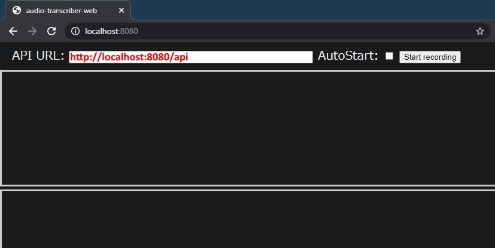

# audio-transcriber-web

[日本語のREADMEはこちらから](README-ja.md)

Transcribes audio from the microphone using the browser's `SpeechRecognition` and writes the transcript to a file.

- [GitHub Pages](https://book000.github.io/audio-transcriber-web/static/index.html)
- For transcriptions from video and audio files: [book000/audio-transcriber-docker](https://github.com/book000/audio-transcriber-docker)

## Warning / Disclaimer

**The author is not responsible for any problems caused by the user using this project.**

Or rather, if you want to use it seriously, use [Google Cloud Platform Speech-to-Text](https://cloud.google.com/speech-to-text).  
We do not provide any support.

## Feature

- Enter an `API URL` to automatically send the transcribed text to that address.
- With the `AutoStart` feature turned on, recording starts the moment you visit or reload the page. (beta)
- With `Display timestamp` turned on, each result shows its date and time instead of the elapsed seconds.
- The `API URL`, `AutoStart`, and `Display timestamp` settings are stored in [localStorage](https://developer.mozilla.org/en/docs/Web/API/Window/localStorage).
- Hover over a result to see the recognition alternatives and their diffs.

## Requirements

- Chrome 33+ / Edge 79+ ([Can I use SpeechRecognition?](https://caniuse.com/mdn-api_speechrecognition))
- Python 3.11+ (only for the Python backend)
- `requirements.txt`: fastapi, uvicorn

## Installation & Usage

### 1. Git Clone

`git clone https://github.com/book000/audio-transcriber-web.git`

### 2. Install packages from `requirements.txt`

`pip3 install -U -r requirements.txt`

### 3. Run `main.py --open-browser`

`python3 main.py --open-browser`

### 4. Type `http://localhost:8080/api` in the `API URL` form



### 5. Click the `Start recording`

If you turn on `AutoStart`, recording will start the moment you access the page.

## Notes

- Permission, service, microphone, and other non-retryable recognition errors stop recording. Resolve the reported problem, then click `Start recording` to try again. Network errors, no-speech errors, and ends without a final transcript trigger at most three consecutive retries after 1, 2, and 4 seconds. A non-empty final transcript resets that limit; `Stop recording` cancels a pending retry.
- Transcripts are saved as `<YYYY-MM-DD HH-MM-SS>.log` and `.json`, named after the recording start time (server-local time). `main.py` writes them to `data/`; `api.php` writes them to the directory named by the `TRANSCRIPT_DATA_DIR` environment variable.
- Uploads are queued in recognition order. Both backends require a positive integer `revision` (at most `9007199254740991`) that increases within each recording; upgrade the frontend and backend together. Older or duplicate revisions cannot replace saved speech.
- Both backends validate the JSON object before writing. `startTime` must be a number from `0` (inclusive) to `4102444800` (exclusive, 2100-01-01 UTC); fractional seconds are truncated. `transcript` must be a string of at most 65,536 UTF-8 bytes. `full` must be an array of at most 10,000 objects, each with an integer `timeStamp` from `0` to `4102444799` (elapsed seconds) and a `transcript` string with the same byte limit. The combined transcript text in `full` must not exceed 1,048,576 UTF-8 bytes. Empty strings and empty arrays are allowed. Unknown fields are ignored; top-level `timeStamp` remains optional and unused. Invalid input returns HTTP 422 (Python) or 400 (PHP) without changing the saved snapshot; storage failures return HTTP 500.
- Keep the session `.snapshot.json` and `.lock` sidecars alongside the transcript exports. The snapshot stores the accepted revision and full transcript; a later request repairs incomplete exports from it. Each file is replaced atomically under the session lock, but the files are not published as one atomic group.
- It also works if you put `api.php` on a server somewhere and set its address as the `API URL`.
  - Set `TRANSCRIPT_DATA_DIR` for PHP to an absolute path **outside the web server's document root** whose parent directory exists (only the last component is created). Anything inside the document root can be downloaded by anyone who guesses a recording timestamp. Until it is set, `api.php` answers HTTP 500 to `POST` and `HEAD` and writes nothing.
  - For PHP-FPM, add `env[TRANSCRIPT_DATA_DIR] = /var/lib/audio-transcriber` to the pool configuration. For nginx with FastCGI, add `fastcgi_param TRANSCRIPT_DATA_DIR /var/lib/audio-transcriber;`. The PHP user must be able to write there.
  - Upgrading from a version that wrote to `<document root>/data/`: set the variable, then move the old files out of the document root by hand.
- The frontend alone works without a backend: open `static/index.html` (or the GitHub Pages URL) and leave `API URL` empty.

## Tests

```bash
node tests/speech-recognition-support.test.js
python3 -m unittest discover -s tests -p 'test_*.py' -v
```

The Python tests use the installed `requirements.txt` dependencies and start an isolated HTTP backend in a temporary directory. They cover reordered and concurrent snapshots, revision persistence across restarts, invalid JSON and field types, timestamp and UTF-8 size boundaries, storage failures, and export recovery. To run the same cases against PHP, serve a disposable copy of `api.php` with `TRANSCRIPT_DATA_DIR` set to `<directory>/data`, then set `TRANSCRIBER_TEST_URL` to its URL and `TRANSCRIBER_TEST_DIRECTORY` to `<directory>`. The PHP server must use the same time zone as the test runner, because file names use server-local time. The external-backend restart case is skipped; verify PHP restart persistence separately.

## License

The license for this project is [MIT License](https://github.com/book000/audio-transcriber-web/blob/master/LICENSE).

This project contains several libraries. The library licenses are as follows.

- [axios](https://github.com/axios/axios) MIT License, Copyright (c) 2014-present Matt Zabriskie
- [jsdifflib](https://github.com/cemerick/jsdifflib) BSD license, 2007 - 2011 Chas Emerick
